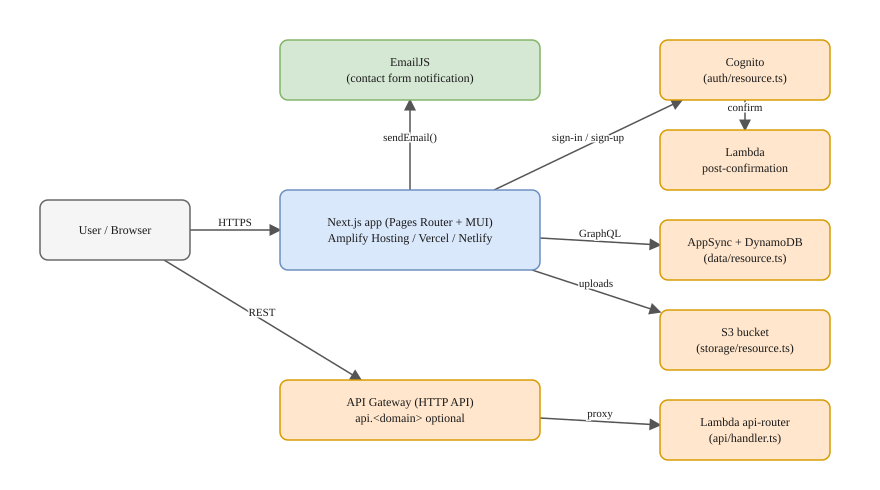

# Diagrams

Architecture and flow diagrams for stakeholders — technical or not — and for
developers learning how the app fits together.

| Diagram                                 | Shows                                                                              |
| --------------------------------------- | ---------------------------------------------------------------------------------- |
| [Architecture](architecture.drawio.svg) | Browser, Next.js hosting, and the Amplify Gen 2 backend (auth, data, storage, API) |

## Format: `.drawio.svg`

Each diagram is a single `.drawio.svg` file. It is **both**:

- a normal SVG — GitHub, docs sites, slides and meeting decks render it as an image, and
- an editable [draw.io](https://github.com/jgraph/drawio) diagram — the source is embedded in the file.

So there is no separate "export" step and no image that can drift from its source.

## View and edit

- **VS Code** (recommended): install the _Draw.io Integration_ extension
  (`hediet.vscode-drawio`, already in `.vscode/extensions.json`) and open the file.
- **Browser**: open <https://app.diagrams.net>, choose _Open Existing Diagram_, pick the file, and save back to the same path.
- **Desktop**: [draw.io Desktop](https://github.com/jgraph/drawio-desktop).

When saving, keep the **`.drawio.svg`** extension (in draw.io: _File → Export as → SVG_ with
_Include a copy of my diagram_ ticked, if you are not using the VS Code extension).

## Conventions

- One concern per diagram; name files `<topic>.drawio.svg` (kebab-case).
- Label every arrow with what flows over it (protocol, event, call).
- Colours: blue = application, orange = AWS service, green = third-party, grey = people/clients.
- Use a white page background so the diagram stays readable in dark-mode viewers.
- Update the diagram in the same PR that changes the architecture it describes.
